# PhD Research Workspace · 博士科研工作台

> A self-hosted research planner for PhD students: daily / weekly planning with a focus timer, a paper library with multi-round reading plans, idea and project tracking, submission deadlines, and a feed inbox. Vue 3 + Hono on Cloudflare Pages + D1, private by default behind Cloudflare Access. Five built-in skins. The UI is in Chinese.

把**论文阅读、研究想法、周目标、每天的工作和投稿截止**放在一个只属于你自己的网站里。部署在你自己的 Cloudflare 账户上（免费额度通常够个人使用），默认只有你的邮箱能登录。

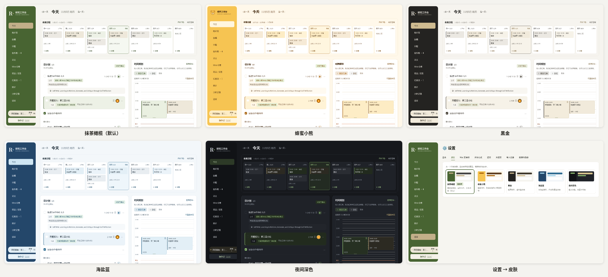

## 目录

- [页面功能](#页面功能)
- [皮肤](#皮肤)
- [可选组件](#可选组件)：Claude MCP · ChatGPT 日报归档 · Codex 定时上传 · Mac 菜单栏计时 · 手机
- [本地试用](#本地试用)
- [部署到自己的 Cloudflare](#部署到自己的-cloudflare)
- [导入论文](#导入论文) · [备份与恢复](#备份与恢复) · [数据与隐私](#数据与隐私) · [开发与测试](#开发与测试)

截图里的论文都是公开的经典论文，其余内容是虚构的示例数据（`scripts/demo_data.py` 生成）。

---

## 页面功能

### 今日

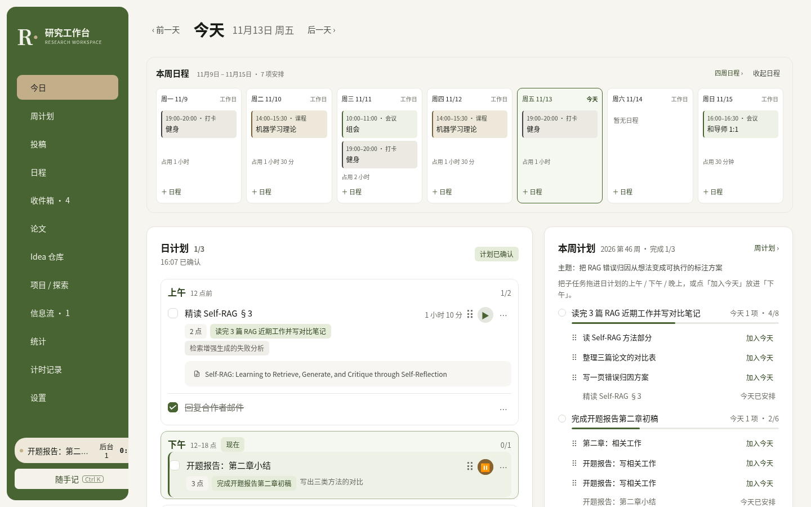

每天打开的第一页。

- **本周日程总览**：所在周七天的会议、课程、打卡、休息，以及每天被占用的时长；点日期切换，点日程直接编辑。
- **日计划**：写下今日目标即「打卡」；打卡时已有的任务是计划内，之后临时加的记为「计划外」，单独显示、不计入完成率。任务可以挂到周目标、关联多篇论文、设工作量点数（1 / 2 / 3 / 5）和完成标准。 日计划按 **上午 / 下午 / 晚上** 分段（12 点、18 点为界），当前时段高亮，各段显示这段时间里的课程和会议；添加任务时选时段，任务可以在几段之间拖动。
- **时间规划**：00:00–24:00 的竖向时间轴。把任务拖到某个时段、拖底边调整时长；同一任务可以排多个时段。会议、课程也显示在轴上，重叠会提示。计划时段不会算进工时。 平时收起，需要排到具体几点时再展开；排好后任务的上午 / 下午 / 晚上跟着变。
- **本周计划**：这周的目标和完成进度，每个目标下列出还没做完的子任务，拖进日计划的某一段，或点「加入今天」放进当前时段；编辑目标仍在周计划页。
- **专注计时**：同一时间只有一个专注计时，可暂停 / 继续，电脑和手机同步；跨零点自动按日期拆分统计。
- **后台任务**：跑实验、下载数据这类不需要盯着的事，可以同时开多个后台计时，单独记录，不计入专注工时和评分。
- **投稿倒计时**：你确认要投的会议，显示最近的截止节点。投完点「完成投稿」，这个会议就离开倒计时，评审公布、作者回复截止、录用结果等后续节点放进日程。
- **晚间复盘**：结论、卡点、明天先做什么；心情和精力只用于自我观察，不参与评分。

### 周计划

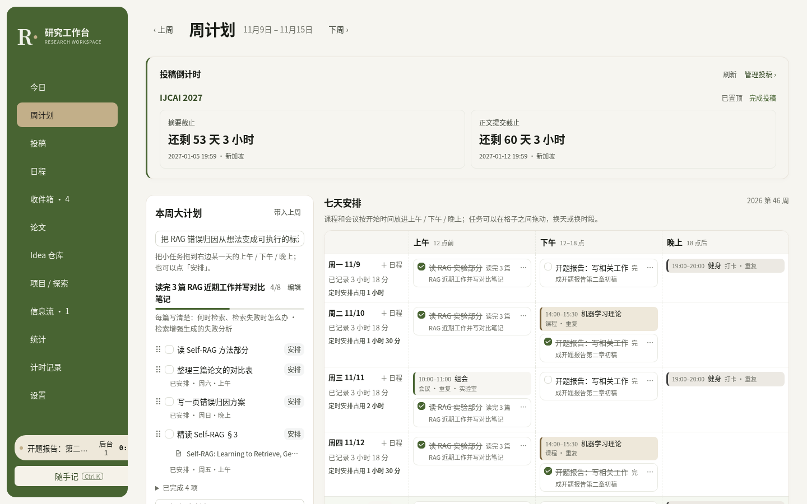

- **本周主题与周目标**：每个目标有权重、截止日、完成标准；目标下可以加勾选子任务。左侧的任务池固定在屏幕上，只列没做完的小任务。
- **排期板**：右侧每天一行，分 上午 / 下午 / 晚上 三格，一屏放下整周。课程和会议按时间出现在对应格子里；把小任务拖进某天某段，格子之间拖动换天或换时段，手机上点「安排」选日期和时段。一个子任务可以分几天做，完成后各天记录同步。
- **执行评分**：按目标权重和进度计算，进行中的周期显示「当前累计」和「截至今天应完成的目标」，周期结束才算最终分。
- **周复盘**：分「得到的结论」「排除的假设 / 路线」「仍未解决的问题」——有依据地排除一条错误路线，也是进展。

### 投稿

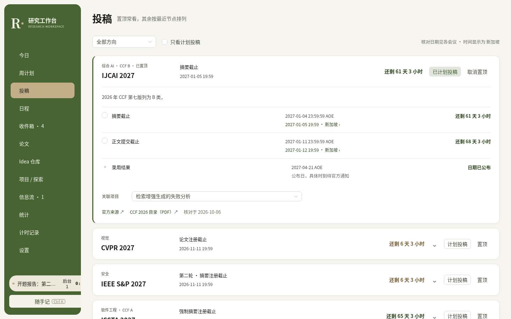

- 预置一份 AI / 机器学习 / NLP / 视觉 / 安全 / 软件工程会议目录（官方链接与核对日期见 `server/data/conferences.ts`），每个会议标注 CCF 等级，可以按方向筛选。
- AOE 截止时间自动换算成你的时区；官方还没公布的日期标为待定，不会编造倒计时。
- **计划投稿 → 确认**之后，才会出现在今日 / 周计划 / 日程 / 项目的倒计时里；可以关联项目、逐项勾选提交进度（摘要、正文、补充材料、rebuttal）。
- **完成投稿**：论文交上去以后点一下（会再确认一次），本轮的摘要注册和正文提交一起勾上，会议离开倒计时，列表里改为显示「下一步」和还有几天。评审公布、录用结果这类只有日期的节点标为「公布日」放进日程；作者回复等截止从评审公布那天起回到倒计时（没有评审公布日的会议提前 7 天回来）。多轮投稿的会议只勾当前这一轮。点错了可以在「已投稿」里撤销，投稿计划和关联项目都保留。

> 会议日期是人工核对的快照，请在官网确认后再依赖；欢迎提 PR 更新。

### 日程

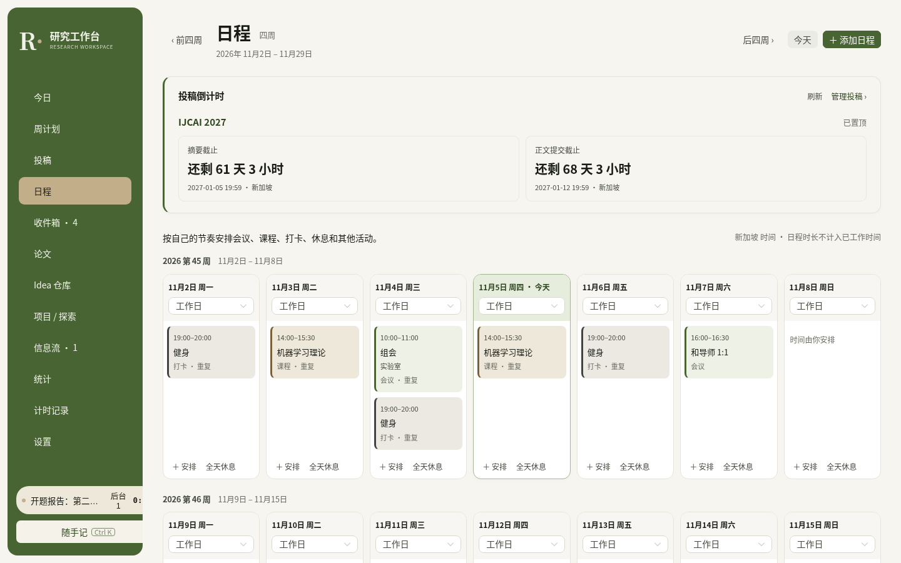

- 一次显示连续四周，前后翻页。
- 类型：会议、课程、打卡、休息、其他；支持每天 / 每周 / 每两周重复，修改时可选「仅本次」或「本次及以后」。
- 每天默认是工作日，不预设上下班时间；可以把某天设为休息或请假（不计入应打卡天数）。
- 计划投稿的会议的截止节点显示在对应日期；已投稿的会议还会显示评审公布、录用结果等公布日。

### 收件箱

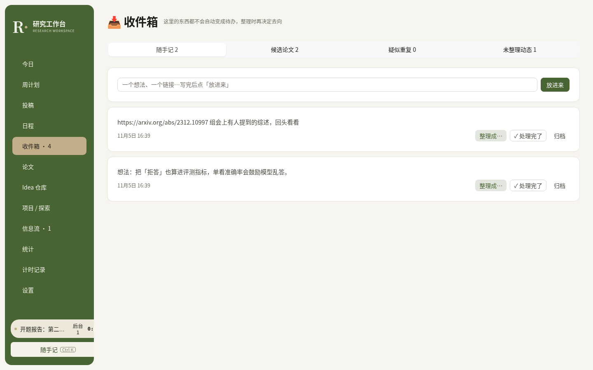

所有「待整理」的东西都在这里，**都不会自动变成待办**：

- **随手记**（任何页面按 Ctrl / ⌘ + K）：想法、链接，之后再整理成任务、Idea、论文或项目。
- **候选论文**：从信息流、对话里推荐来的论文先进这里，你决定放进清单（可同时建阅读计划）还是拒绝；拒绝过的同一篇以后不会再出现。
- **疑似重复**：标题相似但没有可靠标识符的论文，等你确认是否合并。
- **未整理的动态**。

### 论文

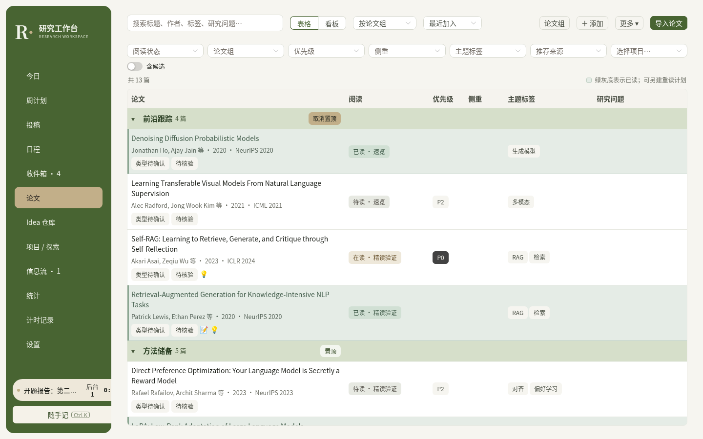

- **论文组**（集合）分组的表格，可以按阅读状态、优先级、侧重、主题标签、推荐来源、项目筛选；还有看板视图，手机上是卡片列表。读过的论文整行浅色背景。
- **论文资料、阅读计划、阅读记录分开保存**：一篇读过的论文可以为新的目的再读一轮（例如先速览，之后为某个 Idea 精读验证），每轮有阅读原因、目标深度、重点章节和完成标准。
- 详情抽屉：资料 / 阅读 / 笔记（Markdown + 公式）/ 关联 / 附件 / **溯源**——每次被谁推荐、从哪次导入、哪个字段被改成了什么，都有记录。
- 导入：飞书 CSV、JSON、BibTeX、Markdown 表格、链接列表；从 arXiv 补全元数据；分级查重；整批撤销（见[导入论文](#导入论文)）。

### Idea 仓库

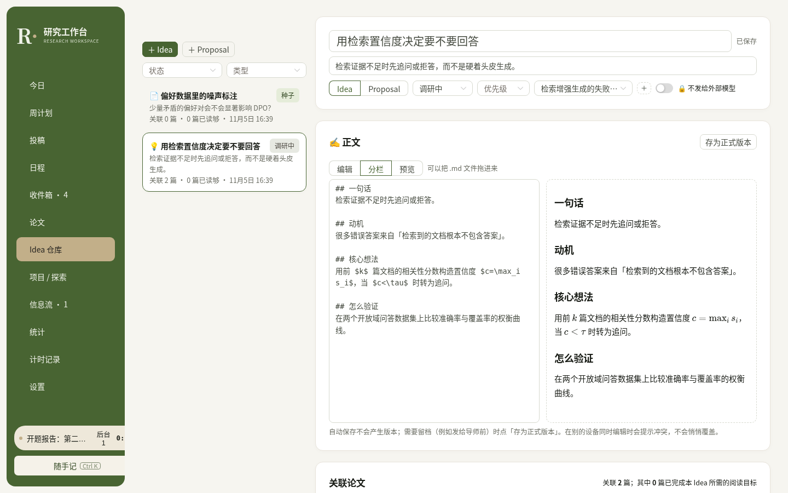

- Idea / Proposal 模板，Markdown 分栏编辑（支持公式）。自动保存不产生版本，需要留档时点「存为正式版本」；两台设备同时编辑会提示冲突，不会悄悄覆盖。
- 关联论文时显示「关联 N 篇，其中 M 篇已完成本 Idea 所需的阅读目标」，可以一键「为这个 Idea 再读一次」。
- 默认「不发送给外部模型」：通过 MCP 等对话入口读取时只返回标题。
- **附件**：Idea、论文、笔记都可以挂文件（按钮或拖放；单个 ≤ 10 MB，总量 ≤ 200 MB），例如实验表格、PDF。文件存在你自己的 D1 里，和其他数据一样在登录之后；下载链接可以直接写进正文。删除 Idea / 论文 / 笔记时附件一起删除，删除前会提示数量。

### 项目 / 探索

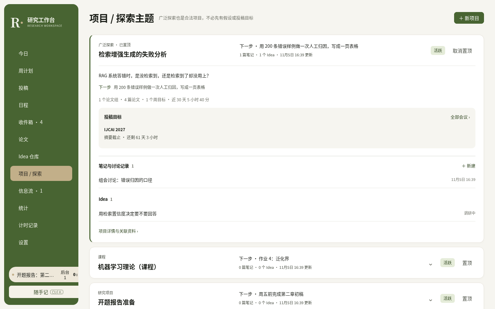

比周目标高一层、跨周跨月存在的研究方向。广泛探索也可以是一个项目，不必先有假设。记录当前核心问题、下一步、状态；周目标、论文组、Idea、笔记、讨论记录、投稿目标都可以挂在项目下。置顶的项目常展开。

### 笔记

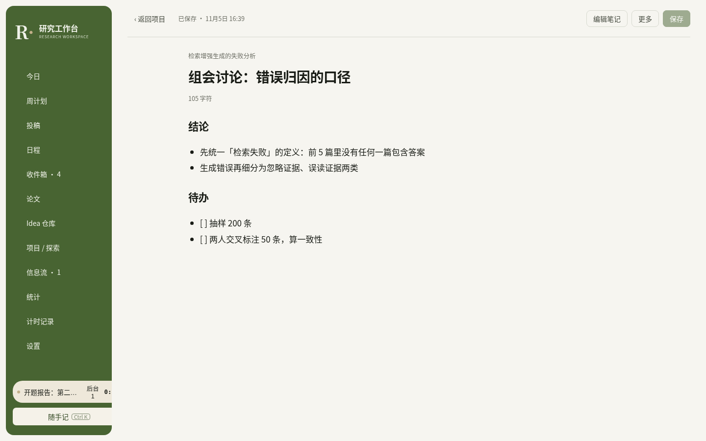

长笔记的独立阅读 / 编辑页：保存栏固定在顶部（⌘ / Ctrl + S），编辑区与预览各自滚动；保存失败保留草稿，离开未保存页面会提醒。页面底部可以挂附件。

### 信息流

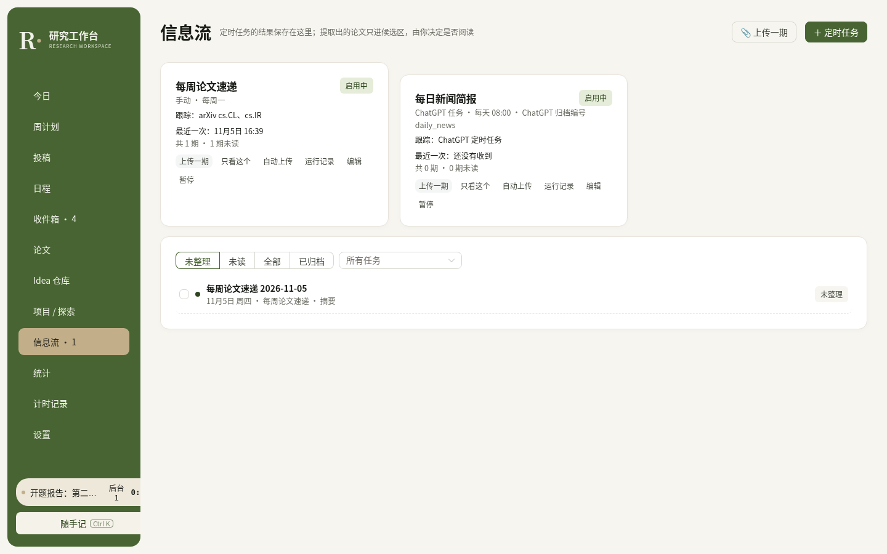

定时任务（Newsletter 整理、每日简报等）的结果都存在这里：每期动态的「是否读过」「整理到哪一步」「是否归档」分开记录；提取出的论文只进候选区。支持手动上传 Markdown、[Codex 定时任务上传](#codex-定时上传)和 [ChatGPT 定时任务归档](#chatgpt-日报归档)。

### 统计

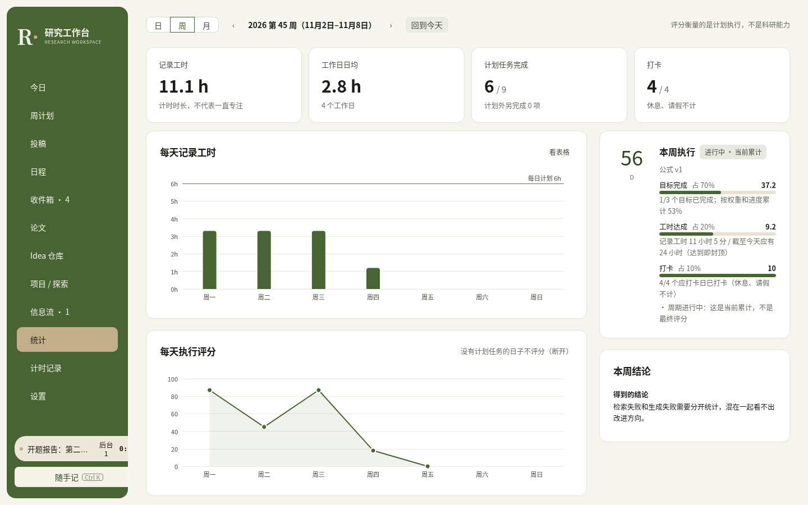

日 / 周 / 月视图：每天记录工时、每天执行评分、时间花在哪个项目 / 论文 / 任务、最近半年热力图。评分只衡量**计划执行情况**，不代表科研能力；公式和权重写在页面上，改权重会生成新版本、不影响历史分数，也可以关掉等级显示。

### 计时记录

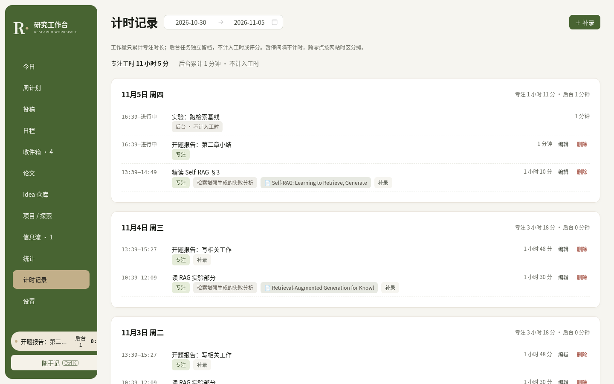

专注和后台记录并列，可以补录、修改（同一段时间不能重复计时）。

### 设置

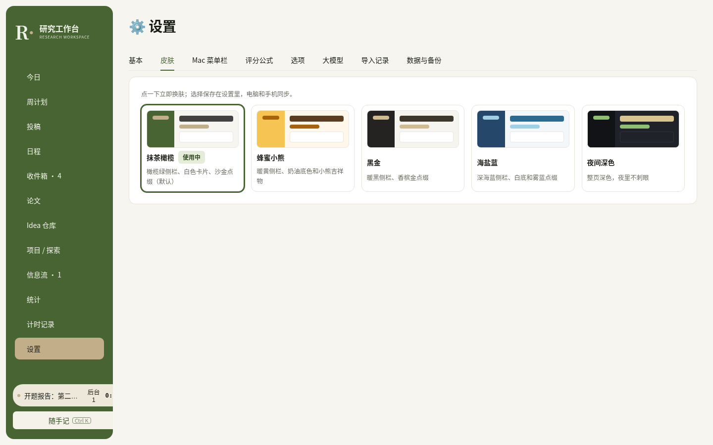

皮肤、工作日与计划工时、评分公式、下拉选项、Mac 菜单栏小工具下载、大模型（默认关闭）、导入记录（查看原文 / 撤销）、完整数据备份下载。

---

## 皮肤

设置 → 皮肤，点一下立即生效，电脑和手机同步。

| 皮肤 | 风格 |
| --- | --- |
| 抹茶橄榄（默认） | 橄榄绿侧栏、白色卡片、沙金点缀 |
| 蜂蜜小熊 | 暖黄侧栏、奶油底色、小熊吉祥物和手写体标题 |
| 黑金 | 暖黑侧栏、香槟金点缀 |
| 海盐蓝 | 深海蓝侧栏、白底、雾蓝点缀 |
| 夜间深色 | 整页深色，夜里不刺眼（图表、表格、日程都有深色配色） |

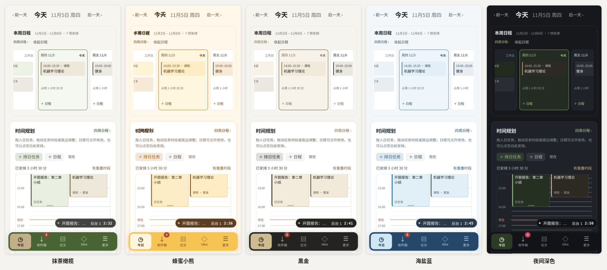

**自己做一套**：所有颜色都是 CSS 变量。在 `web/src/themes.css` 复制一段 `:root[data-theme='…']`、改颜色，在 `web/src/lib/theme.js` 的 `THEMES` 和 `server/db.ts` 的 `THEME_IDS` 里各加一项即可。改完运行 `python3 scripts/check_theme_contrast.py` 检查文字对比度（正文 ≥ 4.5:1）。

---

## 可选组件

不配置这些也能完整使用网站。

### Claude MCP

在 Claude 电脑端（或任何支持 MCP 的客户端）里直接说「把这几篇论文加进候选区」「今天的任务是…」「开始计时」。`mcp/honey-mcp.mjs` 是零依赖的 stdio MCP 服务，共 32 个工具（包括把本机文件挂成附件）。低风险操作直接完成；覆盖个人内容、撤销导入、删除论文或附件会先返回预览，你确认后才执行。配置见 [mcp/README.md](mcp/README.md)。

### ChatGPT 日报归档

让 ChatGPT 的定时任务（Scheduled Tasks）在生成报告后，把完整 Markdown 自动归档到信息流。使用受限的远程 MCP + OAuth：这个授权只能归档你在「信息流」里开启了归档编号的任务，不能读取论文、笔记，也不能删除任何东西。设置步骤见 [docs/ChatGPT日报接入.md](docs/ChatGPT日报接入.md)。能否使用取决于你的 ChatGPT 套餐是否支持自定义连接器。

### Codex 定时上传

本地运行的定时任务（例如 Codex）写出 Markdown 后，执行：

```bash
python3 scripts/honey.py feed-upload 报告.md --task-id 1
```

同一文件同一天重试不会重复上传；`--dry-run` 只做本地校验。网站「信息流 → 任务卡片 → 自动上传」可以复制一段现成的说明，粘贴到定时任务末尾。

### Mac 菜单栏计时

设置 → Mac 菜单栏，下载源码安装包，在自己的 Mac 上编译安装（需要 macOS 12+ 和 Command Line Tools）。菜单栏显示专注计时，可以暂停 / 继续、结束后台任务。说明见 [macos/ResearchTimer/README.md](macos/ResearchTimer/README.md)。

### 手机

手机浏览器打开自己的网址，登录后「添加到主屏幕」，用起来像 App；手机和电脑是同一个数据库。iPhone：Safari 分享菜单 → 添加到主屏幕；Android：Chrome 菜单 → 添加到主屏幕。

---

## 本地试用

不需要 Cloudflare 账户，先在本机看一眼（Node.js 22、Python 3.9+）：

```bash
git clone https://github.com/CD22104/phd-research-workspace.git
cd phd-research-workspace
npm ci
npm run build
scripts/dev-test-server.sh /tmp/research-demo 8790 &      # 用一份全新的本地空库启动（会清空这个目录）
python3 scripts/demo_data.py http://127.0.0.1:8790        # 可选：写入截图里的示例数据
```

打开 http://127.0.0.1:8790 。本地测试服务器跳过登录，只用于本机。

## 部署到自己的 Cloudflare

### 你需要准备

1. 自己的 Cloudflare 账户、Account ID 和一个 API Token，权限：**D1 Edit、Cloudflare Pages Edit、Access: Apps and Policies Edit、Access: Service Tokens Edit**。
2. 在 Cloudflare Zero Trust 里建好组织并开启 One-time PIN（邮箱验证码）登录，记下团队域名（例如 `your-team.cloudflareaccess.com`）。参考官方 [Zero Trust 初始化](https://developers.cloudflare.com/cloudflare-one/setup/) 和 [One-time PIN](https://developers.cloudflare.com/cloudflare-one/integrations/identity-providers/one-time-pin/)。
3. 一个还没被占用的 Pages 项目名，例如 `alice-research`。

### 步骤

```bash
# 1. 把模板配置成你自己的实例（项目名、时区）
python3 scripts/configure_instance.py --project alice-research --timezone Asia/Shanghai
npm ci && npm run typecheck && npm test && npm run build

# 2. 填写自己的 Cloudflare 凭证（不要提交到 Git）
cp .env.cloudflare.example .env.cloudflare && chmod 600 .env.cloudflare
#    编辑 .env.cloudflare，然后在同一个终端载入：
set -a; . ./.env.cloudflare; set +a

# 3. 部署
python3 scripts/cf_setup.py --check
python3 scripts/cf_setup.py --owner you@example.com --team-domain your-team.cloudflareaccess.com
```

部署脚本会依次：创建 D1 数据库和 Pages 项目、创建两个只给你用的服务令牌（保存在 `~/.config/<项目名>/service-tokens.env`，权限 600）、创建 Access 应用（只允许你的邮箱登录，正式与预览地址都受保护）、设置服务端配置、迁移数据库、构建发布，最后验证「未登录会被拦下、服务令牌能访问接口」。中途失败可以修复后重跑同一条命令。

### 部署成功后

打开 `https://<你的项目名>.pages.dev`，用邮箱验证码登录，应该看到一个空的工作台：论文、任务、项目都是空的，皮肤为抹茶橄榄。新建一个任务，试试开始 / 暂停 / 结束计时，刷新后状态应当保留。

```bash
python3 scripts/cf_setup.py --verify-only     # 只验收现有部署
python3 scripts/cf_setup.py --deploy-only     # 之后更新代码（也会应用新的数据库迁移）
```

把部署交给 AI 编程助手完成的说明见 [docs/部署给AI助手.md](docs/部署给AI助手.md)。

## 导入论文

网页「论文 → 导入」粘贴或上传；也可以用命令行：

```bash
python3 scripts/honey.py import 论文清单.csv      # 先预览，确认后导入；默认从 arXiv 补全空字段
```

- 支持飞书多维表格导出的 CSV（示例：`tests/fixtures/sample_feishu.csv`）、JSON、BibTeX、Markdown 表格、链接列表；导入对话框里有一段提示词，可以让 Claude / GPT 按 JSON 格式输出推荐。
- arXiv 号、DOI 或链接相同：合并到已有论文，只补空字段，新增一条推荐记录。
- 只有标题相似：作为「疑似重复」等你确认，不自动合并。发表信息不一致时列出差异，由你决定。
- 你的备注、问题、阅读状态和笔记，导入**永远不会覆盖**。
- 每批导入保留原文和字段来源，可以在「设置 → 导入记录」里整批撤销；同一批内容重复提交只导入一次。

## 备份与恢复

```bash
bash scripts/backup.sh          # 数据库快照（.sql）+ 完整 JSON + Markdown 阅读版，输出到 backups/<时间>/
bash scripts/restore_test.sh backups/<时间>/research-workspace.sql backups/<时间>/research-workspace.json   # 恢复演练：导入空库逐表比对
```

附件也在 `.sql` 快照里；附件总量不超过 20 MB 时 JSON 里也有完整内容，否则 JSON 只记附件信息。恢复演练会逐个核对附件的大小和 SHA-256。

Cloudflare D1 另外自带 Time Travel，可以恢复到任意时间点（免费版保留 7 天，付费版 30 天）。备份里是你自己的研究内容，不要放进公开仓库。

## 数据与隐私

- 所有数据都在**你自己的** Cloudflare D1 里；网站和接口都在 Cloudflare Access 之后，只有你的邮箱和你自己生成的服务令牌能访问，后端还会再次校验 Access 签发的登录凭证。
- 大模型默认关闭。只有你在设置里选定提供商、配置了 Key，并在导入时勾选「用大模型解析」，才会把那段粘贴的文字发给模型；日常使用和结构化导入都不需要模型。
- Idea 和笔记默认「不发送给外部模型」；服务器只访问 arXiv 这类固定地址，不会去抓取你粘贴的任意链接。
- 这个仓库只是源码，不含任何人的研究数据，也不会连接到任何其他实例。

## 开发与测试

```bash
npm run typecheck && npm test && npm run build
python3 scripts/check_theme_contrast.py                     # 皮肤对比度

# 接口验收：必须用一份新建的临时空库
scripts/dev-test-server.sh /tmp/research-test 8799 &
python3 tests/test_api.py http://127.0.0.1:8799 tests/fixtures/sample_feishu.csv
npm run test:feed-bridge                                     # 信息流 / 日报归档 / 计时（自带临时库）
```

`tests/` 里还有日程、周计划、投稿、笔记等接口与浏览器测试，文件开头写了用法；浏览器测试需要 Playwright 和 Chromium。数据库结构改动请新增 `migrations/00xx_*.sql`，不要修改已有迁移。更多约定见 [AGENTS.md](AGENTS.md)。

| 目录 | 内容 |
| --- | --- |
| `web/` | Vue 3 + Naive UI + ECharts 前端 |
| `server/`、`functions/` | Hono 后端与 Cloudflare Pages Functions 入口 |
| `migrations/` | D1 数据库迁移 |
| `scripts/` | 初始化、部署、命令行、导入、备份 / 恢复、示例数据 |
| `mcp/` | Claude MCP 服务 |
| `macos/` | Mac 菜单栏计时小工具 |
| `tests/` | 单元、接口与浏览器测试 |

## 许可证

[MIT](LICENSE)
